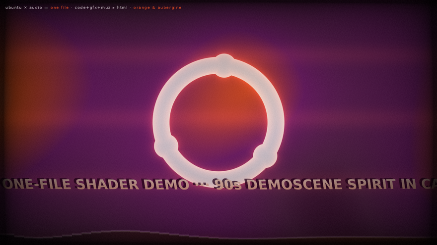

# ubuntu × audio — a 90s-style shader demo



A single self-contained HTML file (`index.html`) — no build step, no dependencies.
A WebGL fragment-shader demo in the spirit of the 90s demoscene, dressed in the
Canonical / Ubuntu colour scheme, reacting to whatever you feed it: the built-in
chiptune, your microphone, or any audio file you drop on it.

## Run it

```sh
python3 -m http.server 8000
# open http://localhost:8000
```

Opening `index.html` directly from a file manager works too (the chiptune and
file-load modes are fine); only the **microphone** mode needs `http://localhost`
or https, plus browser permission.

Hit **▶ start the demo** — a 122.5 bpm tracker-ish tune (kick, snare, hats,
octave bass, delayed arp lead) is synthesized in WebAudio, and everything you
see reacts to the analyser output.

## Controls

| key / button | action |
|---|---|
| ▶ start | start the demo with the built-in chiptune |
| 🎙 / `m` | switch to microphone input |
| 🎵 / `o` | load any audio file (loops, becomes the new soundtrack) |
| 🔊 | mute / unmute |
| ⛶ / `f` | fullscreen |
| `esc` | show / hide the intro panel |

## The show (48 s loop, crossfaded every 16 s)

1. **plasma** — the classic sine plasma with copper bars and a glowing
   circle-of-friends logo pulsing on every kick
2. **tunnel** — infinite procedural tunnel, the spectrum painted around its
   walls, the logo waiting at the end of it
3. **raymarched logo** — the circle of friends extruded in 3D (an SDF prism),
   spinning like a coin above an aubergine checkerboard with orange grid glow,
   soft shadows and a halo that breathes with the bass

Overlays: spectrum bars along the bottom, a slanted greetings scroller, then a
CRT grade (curvature, scanlines, vignette, grain, kick flash).

## How audio drives it

- 256 FFT bins → a 256×1 luminance texture → sampled by the shader per pixel
- `bass/mid/high` smoothed bands + a kick detector (bass vs. slow moving
  average) → the `beat` uniform → logo scale pulses, tunnel wobble, flashes
- when no audio is playing yet, a synthetic groove feeds the same uniforms so
  the intro screen dances too

## Palette (Canonical core)

| colour | hex |
|---|---|
| ubuntu orange | `#E95420` |
| light aubergine | `#77216F` |
| mid aubergine | `#5E2750` |
| dark aubergine | `#2C001E` |
| warm grey | `#AEA79F` |
| base white | `#F7F7F7` |

## Notes

- WebGL 1.0 / GLSL ES 1.00 — runs anywhere, including software rasterizers
  (verified with headless Chromium on SwiftShader)
- debug stills: `index.html?t=<seconds>` freezes the timeline (e.g. `?t=36`
  for the raymarch scene)
- the mark is a hand-made procedural approximation of the circle of friends,
  drawn as an SDF for fun; *Ubuntu and Canonical are trademarks of Canonical Ltd.*

## License

Apache-2.0 — see [LICENSE](LICENSE).
- timing knobs: `SEG` (scene length), `BPM`, and the patterns
  (`ROOTS`, `LEAD`) are plain arrays at the top of the audio section